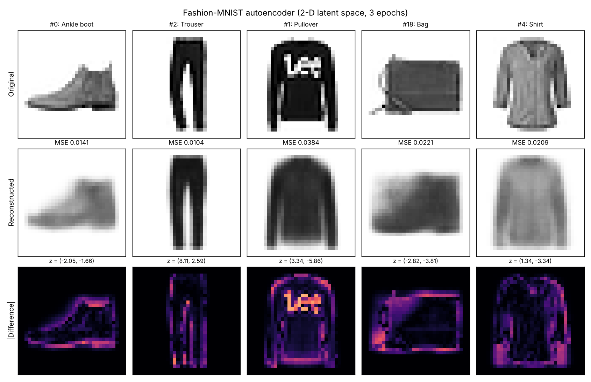

# Fashion-MNIST Autoencoder

A convolutional autoencoder trained on the [Fashion-MNIST](https://github.com/zalandoresearch/fashion-mnist) dataset, based on the autoencoder example from *Generative Deep Learning, 2nd Edition* (David Foster), chapter 3.

## What's here

| File | Description |
|---|---|
| `Assignment3_Autoencoder.ipynb` | Full notebook: data prep, encoder, decoder, training, reconstruction and discussion (already run, outputs included) |
| `reconstructions.png` | 5 test images: original vs. reconstruction vs. pixel difference |

## Model

- **Encoder:** 3 × Conv2D (32 → 64 → 128 filters, stride 2, ReLU) → Flatten → Dense(2)
- **Decoder:** Dense → Reshape → 3 × Conv2DTranspose (128 → 64 → 32, stride 2, ReLU) → Conv2D(1, sigmoid)
- **Latent space:** 2 dimensions
- **Training:** Adam, binary cross-entropy, batch size 100, 3 epochs. Validation loss is about 0.255.

## Results



The model keeps each item's overall shape, size and brightness, but the reconstructions come out blurry and lose fine details such as logos, laces, buttons, collars and bag handles. Squeezing a 32×32 image into only 2 numbers keeps just the coarse features. Simple shapes like trousers reconstruct best. Detailed or easily confused items, like the patterned pullover, shirts and bags, reconstruct worst.

## Run it

```bash
pip install tensorflow matplotlib numpy
jupyter notebook Assignment3_Autoencoder.ipynb
```
